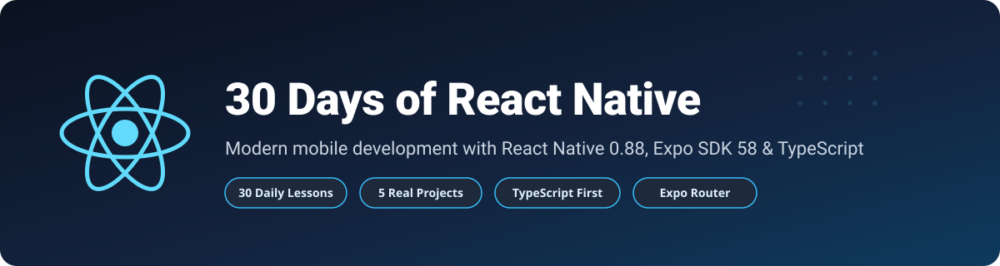

<p align="center">
  
</p>

<h1 align="center">30 Days of React Native</h1>

<p align="center">
  <strong>A practical, 30-day open-source curriculum to master modern mobile development with React Native, Expo, and TypeScript — from your first native screen to production app store releases.</strong>
</p>

<p align="center">
  <a href="./LICENSE"></a>
  
  
  
  <a href="./CONTRIBUTING.md"></a>
</p>

---

Inspired by [`asabeneh/30-days-of-python`](https://github.com/asabeneh/30-days-of-python), **30 Days of React Native** is a hands-on, structured learning repository built around **React Native 0.88**, **Expo SDK 58**, **Expo Router**, and **strict TypeScript**.

Each day focuses on one practical skill with plain-English explanations, React Web vs. React Native comparisons, runnable TypeScript examples, progressive exercises with acceptance criteria and collapsible hints, complete solutions, and a mini project.

---

## Table of Contents

- [Who Should Use This Repository](#who-should-use-this-repository)
- [What You Will Achieve](#what-you-will-achieve)
- [Verified Technology Stack](#verified-technology-stack)
- [Prerequisites and Required Tools](#prerequisites-and-required-tools)
- [How to Start](#how-to-start)
  - [1. Clone and Install](#1-clone-and-install)
  - [2. Run Examples in the Shared Expo Workspace](#2-run-examples-in-the-shared-expo-workspace)
  - [3. Run Type, Lint, and Curriculum Checks](#3-run-type-lint-and-curriculum-checks)
- [Learning Milestones](#learning-milestones)
- [30-Day Learning Roadmap](#30-day-learning-roadmap)
- [How to Practise Every Day](#how-to-practise-every-day)
- [Featured Projects and How to Complete Them](#featured-projects-and-how-to-complete-them)
- [Learning Progress Tracker](#learning-progress-tracker)
- [Daily Progress Checklist](#daily-progress-checklist)
- [Beginner-to-Advanced Learning Paths](#beginner-to-advanced-learning-paths)
- [Technologies Covered](#technologies-covered)
- [Repository Documentation](#repository-documentation)
- [Official Documentation Links](#official-documentation-links)
- [Frequently Asked Questions](#frequently-asked-questions)
- [Contributing](#contributing)
- [Community Resources](#community-resources)
- [Support This Repository](#support-this-repository)
- [License](#license)

---

## Who Should Use This Repository

- **JavaScript or TypeScript developers** who want to build native iOS and Android apps without learning Swift and Kotlin from scratch.
- **React web developers** transitioning from the browser DOM and CSS to React Native components, Flexbox, Expo Router, gestures, and native device APIs.
- **Beginners with basic programming experience** looking for a clear, progressive daily curriculum with real practice exercises and complete solutions.
- **Experienced developers** who want an up-to-date, strict-TypeScript reference for React Native 0.88, Expo SDK 58, testing, accessibility, offline storage, security, and EAS deployment.

---

## What You Will Achieve

By working through the 30 days and 5 featured projects, you will be able to:

- Build responsive, theme-aware iOS and Android interfaces using modern React Native components, Flexbox, and `react-native-safe-area-context`.
- Structure multi-screen navigation (Stacks, Tabs, Nested Layouts, Dynamic Routes, Deep Linking) with **Expo Router**.
- Handle real-world app features: validated forms (**React Hook Form + Zod**), client/server state (**Zustand + TanStack Query**), secure authentication (**`expo-secure-store`**), device hardware (Camera, Location, Haptics, Notifications), and offline persistence (**SQLite + AsyncStorage**).
- Apply professional engineering practices: UI-thread animations (**Reanimated**), `FlatList` optimization, accessibility (VoiceOver & TalkBack), security hygiene, automated testing (**Jest + React Native Testing Library**), and App Store / Google Play deployment via **EAS**.

---

## Verified Technology Stack

Versions and official API recommendations were verified against official documentation on **November 23, 2026**:

| Technology | Version | Notes |
| --- | --- | --- |
| **Expo SDK** | `~58.0.0` | Latest stable SDK (released October 15, 2026) |
| **React Native** | `0.88.0` | New Architecture & Strict TypeScript API enabled by default |
| **React** | `19.3.0` | Compatible React release bundled with RN 0.88 |
| **Expo Router** | `~58.0.0` | Unified SDK versioning; file-based routing in `app/` |
| **TypeScript** | `~5.8.3` | Strict mode + `noUncheckedIndexedAccess` |
| **Node.js** | `22.13+` / `24.3+` (LTS) | Required by Expo SDK 58 tooling (`.nvmrc` targets Node `24`) |
| **Testing** | `jest-expo ~58.0.0` + `@testing-library/react-native` | Official Expo testing ecosystem |
| **Linting** | ESLint v9 Flat Config + Prettier | Modern `eslint.config.js` format |

See [docs/ROADMAP.md](./docs/ROADMAP.md) for the full list of deprecated APIs avoided (such as `SafeAreaView` from `react-native`, `expo-av`, and legacy bridge patterns) and their modern replacements.

---

## Prerequisites and Required Tools

Before starting Day 01, prepare:

- **Basic programming knowledge** (variables, functions, conditionals, arrays/objects). New to TypeScript or React? [Days 02–04](./days/day-02-javascript-typescript/README.md) teach everything you need.
- **Node.js 22.13+ or 24.3+ (LTS)** and **Git** (see [docs/SETUP.md](./docs/SETUP.md) for macOS, Windows, and Linux steps).
- **Code editor:** [Visual Studio Code](https://code.visualstudio.com/) (or your preferred TypeScript IDE).
- **Device or emulator:** An iOS or Android phone with the free **Expo Go** app installed, or Xcode (macOS) / Android Studio for local simulators and emulators. No paid tools are required to complete this course.

---

## How to Start

### 1. Clone and Install

```bash
git clone https://github.com/Hassaan68/30-Days-of-react-native.git
cd 30-Days-of-react-native

# Use Node 24 LTS if you have nvm or fnm installed
nvm use || fnm use

npm install
```

### 2. Run Examples in the Shared Expo Workspace

This repository includes a lightweight **shared Expo Router launcher** inside [`app/`](./app) (`app/_layout.tsx`, `app/index.tsx`, `app/preview/[id].tsx`) so you can run interactive lesson examples and featured project screens live on your phone or simulator without creating 30 separate projects:

```bash
npm start
```

- Scan the QR code with **Expo Go** on your phone, or press **`i`** (iOS Simulator) / **`a`** (Android Emulator).
- Use the search bar on the home screen to filter by day number, topic, or project, then tap any card to run that screen live.

When you want to build a standalone app from scratch (for example, during [Day 01](./days/day-01-introduction/README.md) or any featured project), scaffold a clean app anytime with:

```bash
npx create-expo-app@latest my-rn-app
cd my-rn-app
npx expo start
```

### 3. Run Type, Lint, and Curriculum Checks

```bash
# Check your daily progress from the checklist below
npm run progress

# Run strict TypeScript checking across app/, src/, days/, and projects/
npm run typecheck

# Run ESLint across the repository
npm run lint

# Verify all 30 daily folders, required sections, and internal Markdown links
npm run validate:curriculum
npm run validate:links
```

For full OS-specific setup (macOS, Windows, Linux, iOS Simulator, Android Emulator, physical devices, and Expo Go vs. Development Builds), read [docs/SETUP.md](./docs/SETUP.md).

---

## Learning Milestones

The 30 days are organized into three clear milestones that build progressively from core primitives to production engineering:

### Days 1–7: React Native Foundations & Basic Screens
Learn how React Native and Expo work, strengthen TypeScript and React Hooks fundamentals, master Flexbox layout, theming, safe areas, and core UI components, and ship your first multi-screen **Profile App**.

### Days 8–14: Navigation, Forms, APIs & Application State
Build realistic mobile user flows with **Expo Router** (Stacks, Tabs, dynamic routes, deep links), validated forms (**React Hook Form + Zod**), client & server state (**Context, Zustand, TanStack Query**), secure authentication (**`expo-secure-store`**), native device features, and a live **Weather App**.

### Days 15–30: Advanced Development, Testing, Performance, Security & Production
Level up to professional mobile engineering: UI-thread animations (**Reanimated & Gesture Handler**), `FlatList` performance profiling, offline-first **SQLite** storage, scalable feature-based architecture, native modules & config plugins, automated testing (**Jest & RNTL**), accessibility, mobile security, debugging, notifications, real-time WebSockets, **EAS CI/CD**, a **Task Manager**, and the **PulseTrack** production capstone.

---

## 30-Day Learning Roadmap

Click any day to open its full tutorial, runnable examples, exercises, and solutions.

### Milestone 1 — Days 1–7: Foundations & Basic Screens

| Day | Topic | Level | Status |
| --- | --- | --- | --- |
| [01](./days/day-01-introduction/README.md) | Introduction to React Native and Expo | Beginner | Not started |
| [02](./days/day-02-javascript-typescript/README.md) | JavaScript and TypeScript for React Native | Beginner | Not started |
| [03](./days/day-03-react-fundamentals/README.md) | React Fundamentals | Beginner | Not started |
| [04](./days/day-04-react-hooks/README.md) | React Hooks | Beginner | Not started |
| [05](./days/day-05-styling-and-layout/README.md) | Styling and Layout | Beginner | Not started |
| [06](./days/day-06-core-components/README.md) | Core React Native Components | Beginner | Not started |
| [07](./days/day-07-first-mobile-app/README.md) | Build Your First Mobile App (Profile App) | Beginner | Not started |

### Milestone 2 — Days 8–14: Navigation, Forms, APIs & App State

| Day | Topic | Level | Status |
| --- | --- | --- | --- |
| [08](./days/day-08-navigation-expo-router/README.md) | Navigation with Expo Router | Intermediate | Not started |
| [09](./days/day-09-forms-and-validation/README.md) | Forms and Validation (React Hook Form + Zod) | Intermediate | Not started |
| [10](./days/day-10-state-management/README.md) | State Management (Context API + Zustand) | Intermediate | Not started |
| [11](./days/day-11-api-integration/README.md) | API Integration (Fetch, Axios & TanStack Query) | Intermediate | Not started |
| [12](./days/day-12-authentication/README.md) | Authentication & Protected Routes | Intermediate | Not started |
| [13](./days/day-13-device-features/README.md) | Device Features (Camera, Location, Haptics & More) | Intermediate | Not started |
| [14](./days/day-14-weather-app/README.md) | Build a Weather App | Intermediate | Not started |

### Milestone 3 — Days 15–30: Advanced, Testing, Performance, Security & Production

| Day | Topic | Level | Status |
| --- | --- | --- | --- |
| [15](./days/day-15-animations/README.md) | Animations (Animated API, Reanimated & Gestures) | Advanced | Not started |
| [16](./days/day-16-lists-and-performance/README.md) | Lists and Performance Optimization | Advanced | Not started |
| [17](./days/day-17-local-storage-and-offline/README.md) | Local Storage and Offline Apps (SQLite & Sync) | Advanced | Not started |
| [18](./days/day-18-architecture-and-folder-structure/README.md) | Architecture and Folder Structure | Advanced | Not started |
| [19](./days/day-19-native-modules-and-platform-differences/README.md) | Native Modules and Platform Differences | Advanced | Not started |
| [20](./days/day-20-testing/README.md) | Testing (Jest & React Native Testing Library) | Advanced | Not started |
| [21](./days/day-21-task-manager/README.md) | Build a Task Manager | Advanced | Not started |
| [22](./days/day-22-accessibility/README.md) | Accessibility (VoiceOver, TalkBack & Inclusive UI) | Professional | Not started |
| [23](./days/day-23-security/README.md) | Mobile Security Best Practices | Professional | Not started |
| [24](./days/day-24-debugging-and-devtools/README.md) | Debugging and Developer Tools | Professional | Not started |
| [25](./days/day-25-notifications-and-background-tasks/README.md) | Notifications and Background Tasks | Professional | Not started |
| [26](./days/day-26-backend-and-realtime/README.md) | Backend Integration and Real-Time Features | Professional | Not started |
| [27](./days/day-27-cicd-and-deployment/README.md) | CI/CD and App Deployment (EAS Build & Update) | Professional | Not started |
| [28](./days/day-28-production-readiness/README.md) | Production Readiness & Store Checklists | Professional | Not started |
| [29](./days/day-29-production-mobile-app/README.md) | Build a Complete Production-Style App | Professional | Not started |
| [30](./days/day-30-career-and-open-source/README.md) | Career, Open Source and Next Steps | Professional | Not started |

---

## How to Practise Every Day

Follow this simple 4-step daily loop (~60–120 minutes per day):

1. **Read & Understand (20–30 min):** Open `days/day-XX-.../README.md`, read why the concept matters, study the concepts and React Web vs. React Native notes, and review the expected output.
2. **Run & Tinker (15 min):** Launch the day's interactive example with `npm start` (or inspect the helper module in `examples/`), change a prop or style, and watch Fast Refresh update your phone instantly.
3. **Solve Independently (30–50 min):** Open `days/day-XX-.../exercises/README.md` and implement the **Beginner**, **Intermediate**, and **Challenge** tasks inside the starter file. Check your work against the **Acceptance Criteria** and run `npm run typecheck && npm run lint`. Only open the collapsible **Hints** if you get stuck.
4. **Compare & Consolidate (15 min):** Open `solutions/` *after* trying the exercises yourself, compare trade-offs, build the **Mini Project**, and check off the day in your progress checklist.

---

## Featured Projects and How to Complete Them

Build five real-world applications in [`projects/`](./projects) at key milestones. Each project guide includes features, screens, folder structure, step-by-step build instructions, working TypeScript source files, testing instructions, and extension ideas:

| # | Project | Best Completed After | Focus Areas | Guide |
| --- | --- | --- | --- | --- |
| 01 | **Profile App** | Day 07 | Flexbox, themes, reusable components, safe areas | [View Project 01](./projects/project-01-profile-app/README.md) |
| 02 | **Weather App** | Day 14 | Open-Meteo API (no key needed), search, GPS, refresh | [View Project 02](./projects/project-02-weather-app/README.md) |
| 03 | **Task Manager** | Day 21 | Zustand, AsyncStorage persistence, CRUD, filtering, tests | [View Project 03](./projects/project-03-task-manager/README.md) |
| 04 | **Authentication App** | Day 12 / 23 | SecureStore, React Hook Form + Zod, protected sessions | [View Project 04](./projects/project-04-authentication-app/README.md) |
| 05 | **PulseTrack (Production App)** | Day 29 | Feature-based architecture, offline storage, a11y, error boundaries & tests | [View Project 05](./projects/project-05-production-mobile-app/README.md) |

**How to complete a project:** Preview the reference screen in the shared Expo launcher (`npm start`), read the project's `README.md`, scaffold a fresh Expo app with `npx create-expo-app@latest`, build each screen step by step using the guide, and add at least one feature from the **Future Improvements** section to make it uniquely yours for your portfolio.

---

## Learning Progress Tracker

Track your milestone progress across the curriculum. Fork the repository, check off completed days below, and run `npm run progress` in your terminal to display a live progress bar!

| Milestone | Days | Capstone Project | Progress |
| --- | --- | --- | --- |
| **Milestone 1: Foundations** | Days 01–07 | [Project 01: Profile App](./projects/project-01-profile-app/README.md) | `0 / 7 days` |
| **Milestone 2: Real Mobile Dev** | Days 08–14 | [Project 02: Weather App](./projects/project-02-weather-app/README.md) | `0 / 7 days` |
| **Milestone 3: Advanced & Production** | Days 15–30 | [Project 03](./projects/project-03-task-manager/README.md) & [Project 05](./projects/project-05-production-mobile-app/README.md) | `0 / 16 days` |

---

## Daily Progress Checklist

<details>
<summary><strong>Click to expand your 30-Day Progress Checklist</strong></summary>

- [ ] Day 01: Introduction to React Native and Expo
- [ ] Day 02: JavaScript and TypeScript for React Native
- [ ] Day 03: React Fundamentals
- [ ] Day 04: React Hooks
- [ ] Day 05: Styling and Layout
- [ ] Day 06: Core React Native Components
- [ ] Day 07: Build Your First Mobile App
- [ ] Day 08: Navigation with Expo Router
- [ ] Day 09: Forms and Validation
- [ ] Day 10: State Management
- [ ] Day 11: API Integration
- [ ] Day 12: Authentication
- [ ] Day 13: Device Features
- [ ] Day 14: Build a Weather App
- [ ] Day 15: Animations
- [ ] Day 16: Lists and Performance
- [ ] Day 17: Local Storage and Offline Apps
- [ ] Day 18: Architecture and Folder Structure
- [ ] Day 19: Native Modules and Platform Differences
- [ ] Day 20: Testing
- [ ] Day 21: Build a Task Manager
- [ ] Day 22: Accessibility
- [ ] Day 23: Security
- [ ] Day 24: Debugging and Developer Tools
- [ ] Day 25: Notifications and Background Tasks
- [ ] Day 26: Backend Integration and Real-Time Features
- [ ] Day 27: CI/CD and App Deployment
- [ ] Day 28: Production Readiness
- [ ] Day 29: Build a Complete Production-Style App
- [ ] Day 30: Career, Open Source and Next Steps

</details>

---

## Beginner-to-Advanced Learning Paths

Choose the pace that matches your background (full details in [docs/LEARNING_PATH.md](./docs/LEARNING_PATH.md)):

| Track | Best For | Recommended Route |
| --- | --- | --- |
| **Complete Beginner** | New to React and mobile development | Follow **Days 01 → 30** sequentially (~1.5–2 hours/day) |
| **React Web Developer** | Comfortable with React & TypeScript on the web | Skim Days 02–04, focus on **Days 01, 05–29** |
| **14-Day Fast Track** | Engineers shipping an Expo MVP quickly | Days 01, 05–14, 17–18, 20, 23, 27–29 |
| **Production Readiness** | Intermediate RN devs leveling up to Senior | Days 15–30 + [Project 05](./projects/project-05-production-mobile-app/README.md) |

---

## Technologies Covered

- **Core:** React Native 0.88, Expo SDK 58, React 19.3, TypeScript 5.8
- **Navigation:** Expo Router (Stack, Tabs, Nested Layouts, Dynamic Routes, Deep Linking)
- **Forms & Validation:** React Hook Form, Zod v4, `@hookform/resolvers`
- **State & Data:** Context API, Zustand v5, Fetch, Axios, TanStack Query v5, WebSockets
- **UI, Motion & Media:** StyleSheet, Flexbox, `react-native-safe-area-context`, Animated API, Reanimated, Gesture Handler, `expo-image`
- **Storage & Device APIs:** AsyncStorage, `expo-secure-store`, `expo-sqlite`, `expo-camera`, `expo-image-picker`, `expo-location`, `expo-notifications`, `expo-haptics`, `expo-clipboard`, `expo-sharing`
- **Quality & Shipping:** Jest, `jest-expo`, React Native Testing Library, ESLint Flat Config, Prettier, EAS Build, EAS Submit, EAS Update, GitHub Actions

---

## Repository Documentation

- [Roadmap & Verified Versions](./docs/ROADMAP.md) — Curriculum breakdown, verified package matrix, and deprecated APIs avoided
- [Learning Paths](./docs/LEARNING_PATH.md) — Tailored schedules for beginners, React web devs, and experienced engineers
- [Environment Setup](./docs/SETUP.md) — macOS, Windows, Linux, iOS Simulator, Android Emulator, and physical devices
- [Troubleshooting Guide](./docs/TROUBLESHOOTING.md) — Metro errors, clearing caches, SDK upgrades, RN 0.88 TypeScript fixes, and RN Directory
- [Glossary](./docs/GLOSSARY.md) — Plain-English definitions of React Native & Expo terminology
- [Resources](./docs/RESOURCES.md) — Curated official docs, libraries, tools, and communities
- [FAQ](./docs/FAQ.md) — Answers to common questions

---

## Official Documentation Links

- [React Native Documentation](https://reactnative.dev/docs/getting-started)
- [Expo Documentation](https://docs.expo.dev/)
- [Expo Router Documentation](https://docs.expo.dev/router/introduction/)
- [Expo SDK Changelog](https://expo.dev/changelog)
- [React Documentation](https://react.dev/)
- [TypeScript Handbook](https://www.typescriptlang.org/docs/)
- [React Native Directory](https://reactnative.directory/)
- [EAS (Expo Application Services)](https://docs.expo.dev/eas/)

---

## Frequently Asked Questions

<details>
<summary><strong>Do I need a Mac to follow this course?</strong></summary>

No. You can follow the curriculum on **Windows, macOS, or Linux** using an Android Emulator or a physical iPhone/Android device with Expo Go. When you are ready to build an iOS binary for the App Store, **EAS Build** compiles iOS apps in the cloud without requiring a Mac.
</details>

<details>
<summary><strong>Why does this course use Expo instead of the bare React Native CLI?</strong></summary>

The React Native core team officially recommends starting new React Native projects with a framework like **Expo**. Expo provides file-based routing, first-class TypeScript support, maintained native modules, Continuous Native Generation (CNG), and cloud builds—while still giving you full access to custom Swift and Kotlin native code whenever you need it.
</details>

<details>
<summary><strong>How much time should I spend each day?</strong></summary>

Plan for **60–120 minutes per day**: ~25 minutes reading concepts and expected output, ~35–60 minutes solving exercises independently, and ~20–35 minutes building the mini project. Go at your own pace—consistency beats speed.
</details>

Read more answers in [docs/FAQ.md](./docs/FAQ.md).

---

## Contributing

Contributions from learners and experienced mobile engineers make this curriculum better for everyone! You can help by:

- Clarifying explanations that felt confusing while learning
- Fixing typos, broken links, or outdated snippets
- Adding new exercises, edge-case tests, or translations
- Keeping lessons aligned with future Expo SDK and React Native releases

Please read [CONTRIBUTING.md](./CONTRIBUTING.md) and our [Code of Conduct](./CODE_OF_CONDUCT.md) before opening a pull request.

---

## Community Resources

- [Need Help? Support Guide](./SUPPORT.md)
- [Security Policy](./SECURITY.md)
- [Expo Discord Community](https://chat.expo.dev/)
- [Reactiflux Discord (`#react-native`)](https://www.reactiflux.com/)
- [React Native GitHub Discussions](https://github.com/react-native-community/discussions-and-proposals)

---

## Support This Repository

If **30 Days of React Native** helps you learn mobile development or ship your next app:

- **Star this repository** on GitHub so more developers can discover it.
- **Share your daily progress** (`#30DaysOfReactNative`) and showcase the 5 projects you build.
- **Open a pull request** or suggest improvements via GitHub Issues to help future learners.

---

## License

This project is open source and available under the [MIT License](./LICENSE).
